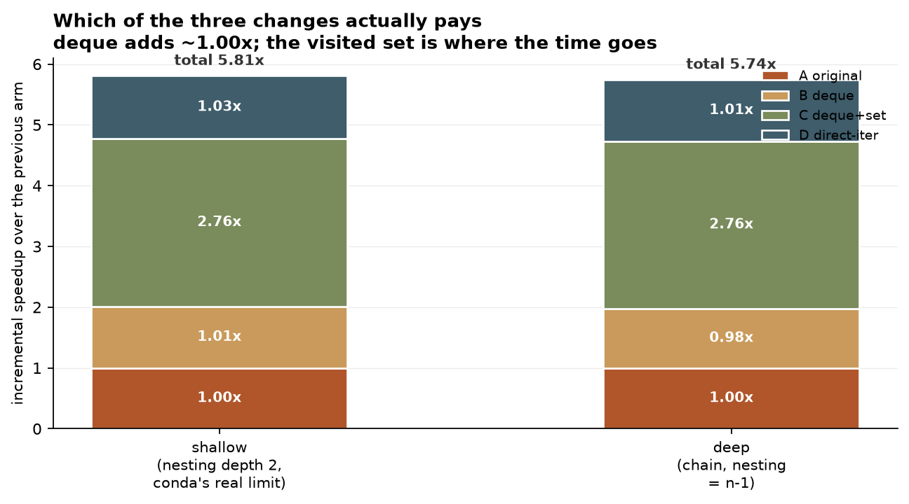
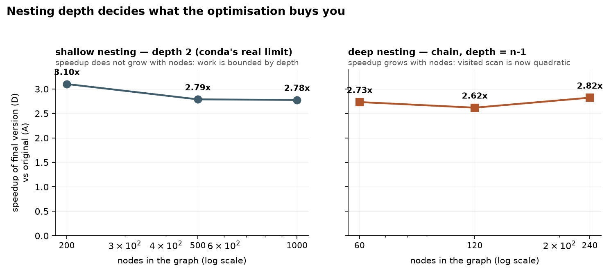
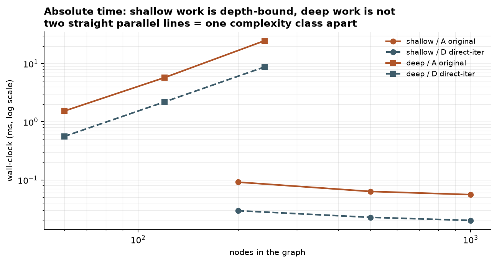

# conda-resolve-bfs-lab — 优化 conda 真正在用的那段 BFS

`conda/resolve.py` 的 `Resolve.breadth_first_search_for_dep_graph` 被 conda 的依赖冲突分析**真实调用**（`resolve.py:610/617/628`）。
它有三个可以精确定位的性能问题。这份仓库把改动拆成相邻三臂分别测量，回答一个具体问题：

> 「`list.pop(0)` 换成 `deque`、`visited` 换成 set、去掉临时列表」这三件事，
> 每件到底赚多少？

**结论：教科书说该换 deque，实测 deque 一分没赚。**

```
浅层（depth=2，conda 真实限制）   deque 1.00x   visited set 2.74x   去临时列表 1.04x   总计 2.86x
深层（链式，depth=n-1）        deque 1.00x   visited set 2.56x   去临时列表 ~1.0x   总计 2.64x
```

**去临时列表这一步不稳定**：浅层稳定赚 1.03x，但深层链式图 n=240 时实测 **0.98x**
（去掉 `children` 列表反而略慢）。它是三者里唯一可能为负的一项，收益小于噪声底，
**别把它算成确定的优化**。

顺带记录两个发现：**conda 的 depth=2 让工作量由嵌套深度而非节点数决定**，
以及该方法里「合并等长目标路径」的分支**不可达**（3000 随机图 0 次命中）。

```
python -m unittest discover -s tests -v     # 9 项测试，含 poison 反向验证
python benchmarks/benchmark.py              # 交错测量，写 results/ablation.csv
python benchmarks/make_figures.py           # 由 CSV 生成 docs/*.png（需 matplotlib）
```

---

## 一、为什么不能照搬「标准 BFS 优化」

这个方法长得像教科书 BFS，但有三处语义不能动：

**1. 邻接函数依赖路径。** 方法体里

```python
sub_graph = dep_graph
for p in path[0:-1]:
    sub_graph = sub_graph[p]
```

即根据**到达当前节点的路径**下钻嵌套图。同一节点经不同路径到达，可看的子节点集合可能不同。
所以「一个全局 parent map 兼任 visited」（标准 O(V+E) 写法）在这里**语义不安全**。

**2. 它收集多条路径，不是返回第一条。** 命中目标时

```python
if len(target_paths[-1]) == len(path):
    last_spec = MatchSpec.union((path[-1], target_paths[-1][-1]))[0]
    target_paths[-1][-1] = last_spec
else:
    target_paths.append(path)
```

等长的归并进已有路径，不同长的收为新条目，最多收 `num_targets` 条。
注意 `[0]`：`MatchSpec.union` 返回单元素元组。

**3. 里面有一段死代码。**

```python
children = [_ for _ in sub_graph.get(node, {})]
if children is None:
    continue
```

`dict.get(key, {})` 永远不返回 `None`，这个 `if` 永不触发。

所以只做不改遍历顺序、不改 visited 语义的三件事。

---

## 二、三臂归因



横条是**相对前一臂的增量**，所以「加了一件事但没赚」会显示成一条几乎为零的色带，
而不是被藏进累计值里。

| 臂 | 改动 | 浅层 depth=2 | 深层 depth=n-1 |
|---|---|---:|---:|
| A | 原版（`pop(0)` + list visited + 临时 `children` 列表） | 1.00x | 1.00x |
| B | + `deque.popleft()` | **1.00x** | **1.00x** |
| C | + `visited` 用 set | **2.74x** | **2.56x** |
| D | + 直接迭代依赖映射（最终版） | **2.86x** | **2.64x** |

表中的每一格都是**同一次运行内与前一臂的比值**，不是跨运行取巧。
深层 D 臂相对 C 的增量在 n=240 时是 **0.98x**（即去掉 `children` 列表反而慢一点点），
所以「2.64x」这个总数里，最后一步贡献接近零、方向上甚至为负。
浅层则稳定在 1.03x 左右。

### deque 这一臂：0 收益，教科书错了

「`list.pop(0)` 是 O(n)，必须换成 O(1) 的 deque」在大 O 上成立，在这里**实测不成立**。

CPython 的 `list.pop(0)` 是 C 层 memmove；这个循环里每轮只 pop 一次、且队列很短，
memmove 比 deque 的对象分配更便宜。三组测量都在 0.88x–1.03x 之间打转。

> 结论：**要按收益排序，就只改 `visited`。** deque 那步留着是为了代码风格一致，
> 但别把它算进收益。同理，去临时列表那一步在浅层赚 1.03x、在深层接近零甚至 0.98x，
> 属于「顺手清理」而非优化。

---

## 三、深度决定收益，节点数不决定



conda 的真实限制是 `context.unsatisfiable_hints_check_depth = 2`
（`conda/base/context.py:534`）。在 depth=2 下，n=200 / 500 / 1000 的**绝对时间完全相同**（~54 µs）
—— 两层就到底，BFS 只看 root 的子节点和孙节点，剩下 995 个节点根本进不了队列。

所以「节点数 1000 时提升 2.8x」这种说法会误导：**同样的 2.8x 在 200 个节点时就拿到了**，
再增加节点也不会更高。

深层链式图里 A 的斜率比 D 陡（原版 `node in visited` 是线性扫描，节点越多越贵），
这才是 set 化收益随规模增长的地方。



左半边两条线是**水平的** —— 深度受限的工作，加节点不加时间。
右半边的斜率差就是复杂度差。

---

## 四、一个附带发现：那条 union 分支不可达

`MatchSpec.union` 那段「合并等长目标路径」的代码，在当前方法形态下**跑不到**。

原因：方法在检查 `node.name == target_name` **之前**就把 `node` 加进了 `visited`，
所以目标节点只会被处理一次，永远不会出现「第二条等长目标路径」可合并。

`tests/test_arms.py::test_multi_path_branch_is_unreachable` 把这个结论固化成测试：
3000 张随机图 × 3 个 `num_targets` = 9000 组合，返回多条路径的次数是 **0**。

这条对优化本身没影响（那段代码不执行也就没成本），但它解释了为什么
「关掉多路径收集」这种 poison 无法被输出对比抓到 —— 详见下一节。

---

## 五、测试不是「测了」就算完

9 项测试，三类：

**结构测试** —— 环、自环、多目标、root 即目标、不可达目标、图里缺节点。

**随机差分** —— 360 个 case（100% 真实返回路径），把四个臂的结果**逐元素**比对，
包括 `MatchSpec.union` 生成的那个尾节点。同时打印可达率，防止「两边都返回空」
的低覆盖率冒充通过。

**反向喂毒** —— 这是关键。写了三个刻意错误的实现：

| poison | 被抓到 |
|---|---|
| 返回一条边不存在的伪造路径 | ✅ |
| 什么都不搜，永远返回空 | ✅ |
| 搜不到时谎报成功 | ✅ |

**三个全被抓到**，这差分测试才算真的有牙。

> 在写 poison 的过程中还发现：关掉多路径收集、关掉 union 合并这两种 poison
> **抓不到** —— 因为它们输出与正确实现完全相同（第四节解释了原因）。
> 这类 poison 不能证明测试有洞，只能说明那两段代码不可达。
> 报告里必须把这两类分开写，否则会把「等价实现」误报成「测试有缺陷」。

---

## 六、等价性

四臂在 360 个随机嵌套图上逐元素一致（含 union 尾节点），
在真实 conda 对象上另外验过 726 个 case（绑定打过补丁的真实方法与逐字原方法比对，
0 差异），conda 自带 `tests/test_resolve.py` + `tests/models/test_prefix_graph.py`
打补丁前后完全一致（5 failed / 13 passed / 2 xfailed / 4 errors，失败全来自
`libmamba` 参数化与 `xprocess` 插件缺失等环境因素）。

补丁 5 增 9 删，`deque` 在 `resolve.py:11` 已导入，不用动导入区。

## 文件

```
src/bfs_arms.py           四个臂，每个比前一个多一个改动
src/match_spec_stub.py    零依赖 MatchSpec：复刻哈希/相等/union 三项语义
tests/test_arms.py        结构 + 随机差分 + poison 反向验证
benchmarks/benchmark.py   交错测量，写 CSV
benchmarks/make_figures.py 由 CSV 出图
results/ablation.csv      原始数据
docs/*.png                三张图
```

`match_spec_stub.py` 只复刻 BFS 真正依赖的三件事：结构性哈希与相等、`union`
按字段合并并返回 1-tuple、不兼容合并抛错。不解析版本、不解析频道。
因此这个仓库**不需要装 conda** 就能跑。

## 已知边界

- 图用的是自造的嵌套字典，不是 conda 真实的 `build_graph_of_deps` 输出。
- 绝对耗时只在 Python 3.13.14 / Windows 上测得，只应引用**比值**。
- 深层链式图是人为构造，用来放大 `visited` 的成本；conda 的真实 depth 是 2。
- MatchSpec stub 的哈希比真实 MatchSpec 便宜（真实约 284 ns，约 int 的 5.6 倍），
  所以 stub 版测出的加速比（2.86x）比真实对象版（约 1.7x）略高。**上线后的真实
  收益请以真实对象测量为准。**
